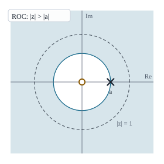
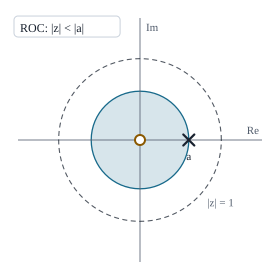
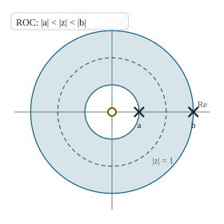
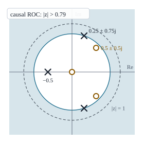
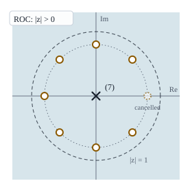
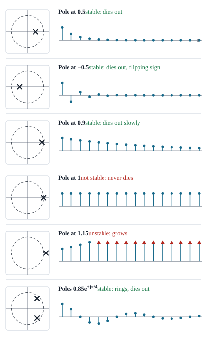
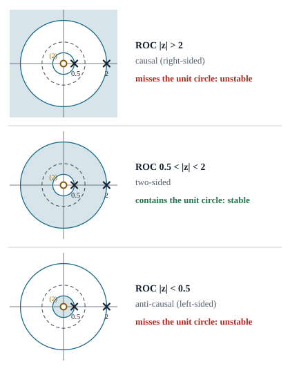

# Topic 2 · The z-Transform and LTI Analysis

*Proakis Chapter 3 · one of the two **Term Test 2** questions (5 marks)*

This follows your class note (`Note/Mid-2 note.pdf`, pages 25–33: Proakis Examples 3.1.1, 3.1.2, 3.1.3, 3.1.5, 3.2.1, 3.2.2 and 3.3.4) and the 2021–22 final paper (Q4a, 4b, 4f, 5a, 5f, 6a, 6b). Every number was checked in Python.

> **The one habit that saves the most marks:** a z-transform without its ROC is only half an answer. Write "ROC: …" under every $X(z)$ you produce.

### The ROC checklist (sir cuts marks for any missing ROC)

**Where an ROC must appear:**

1. **Every $X(z)$, $H(z)$ and $Y(z)$ you write**, including the intermediate ones on the way to the answer, not only the final line.
2. **Every table pair you quote.** The pair *is* the formula together with its ROC.
3. **Every property you use.** Linearity and convolution give "at least $\text{ROC}_1 \cap \text{ROC}_2$". A time shift keeps the ROC "except possibly $z = 0$ or $z = \infty$". Multiplying by $a^n$ scales the ROC by $|a|$. Time reversal turns $|z| > r$ into $|z| < 1/r$.
4. **Every inverse transform.** Say which ROC you are using and what it implies, for example "ROC $|z| > 2$, so both terms are right-sided".
5. **Every system function.** If the question gives no ROC, write "assuming the system is causal, ROC: $|z| >$ (largest pole magnitude)", then compare it with the unit circle to judge stability.
6. **Finite sequences.** Only negative powers of $z$: "all $z$ except $z = 0$". Only positive powers: "all $z$ except $z = \infty$". Both: "all $z$ except $0$ and $\infty$". For $\delta[n]$: "the entire $z$-plane".
7. **Every pole-zero plot.** Shade the ROC and draw the dashed unit circle.

**How to write it:**

- Use magnitudes: $|z| > |a|$, never $z > a$. Since $z$ is complex, "$z > a$" has no meaning.
- Use strict inequalities. The ROC never includes the circle through a pole.
- Add a one-word reason: "(right-sided)", "(left-sided)", "(two-sided, a ring)" or "(finite length)".
- If there is no ROC, say so: "the two regions do not overlap, so $X(z)$ does not exist".

---

## 0. The whole topic in six sentences

1. The z-transform is $X(z) = \sum_n x[n]\,z^{-n}$, where $z = re^{j\omega}$ can be any complex number. On the unit circle ($r = 1$) it is exactly the DTFT.
2. The **region of convergence** (ROC) is the set of $z$ for which that sum converges. The same formula with a different ROC is a different signal.
3. Right-sided signals have an ROC **outside** a circle, left-sided signals have one **inside** a circle, and two-sided signals have a **ring**, or no ROC at all.
4. **Poles** are where $X(z)$ is infinite and **zeros** are where it is zero. The ROC never contains a pole.
5. For an LTI system $Y(z) = H(z)\,X(z)$, which turns a difference equation into algebra.
6. A system is stable exactly when its ROC contains the unit circle. A causal system is stable exactly when **all its poles are inside the unit circle**.

---

## 1. Why do we need the z-transform?

*A 2-mark "define" question.*

The DTFT, $X(e^{j\omega}) = \sum_n x[n]\,e^{-j\omega n}$, does not converge for every signal. For a growing exponential such as $2^n u[n]$ the sum blows up, because $|e^{-j\omega n}| = 1$ does nothing to hold the growth back. The z-transform replaces $e^{j\omega}$, which is stuck on the unit circle, with a general complex number $z = re^{j\omega}$ of any size. That brings in an extra factor $r^{-n}$, which can overpower the growth if $r$ is large enough. So the z-transform is a generalisation of the DTFT.

**Definition.**

$$
X(z) = \sum_{n=-\infty}^{\infty} x[n]\,z^{-n},
\qquad
\text{ROC} = \{\, z : X(z) \text{ converges} \,\}.
$$

**How is it related to the DTFT and the DFT?** (final 4b) The DTFT is the z-transform evaluated on the unit circle, and the DFT samples that circle at $N$ equally spaced points:

$$
X(e^{j\omega}) = X(z)\Big|_{z = e^{j\omega}},
\qquad
X[k] = X(z)\Big|_{z = e^{j2\pi k/N}}.
$$

---

## 2. Finite-length sequences (Proakis Ex 3.1.1)

*A likely warm-up part.*

For a finite sequence the z-transform is just a polynomial: each sample $x[n]$ becomes the term $x[n]\,z^{-n}$. The arrow marks the sample at $n = 0$.

| $x[n]$ | $X(z)$ | ROC |
|---|---|---|
| $\{\underset{\uparrow}{1}, 2, 5, 7, 0, 1\}$ | $1 + 2z^{-1} + 5z^{-2} + 7z^{-3} + z^{-5}$ | all $z$ except $z = 0$ |
| $\{1, 2, \underset{\uparrow}{5}, 7, 0, 1\}$ | $z^2 + 2z + 5 + 7z^{-1} + z^{-3}$ | all $z$ except $z = 0$ and $z = \infty$ |
| $\{\underset{\uparrow}{0}, 0, 1, 2, 5, 7, 0, 1\}$ | $z^{-2} + 2z^{-3} + 5z^{-4} + 7z^{-5} + z^{-7}$ | all $z$ except $z = 0$ |
| $\delta[n]$ | $1$ | the entire $z$-plane |
| $\delta[n-k]$, $k > 0$ | $z^{-k}$ | all $z$ except $z = 0$ |
| $\delta[n+k]$, $k > 0$ | $z^{k}$ | all $z$ except $z = \infty$ |

**The rule behind the ROC column:** a negative power such as $z^{-1} = 1/z$ blows up at $z = 0$, and a positive power such as $z$ blows up at $z = \infty$. Look at which powers appear and exclude those points.

---

## 3. The infinite sequences you must be able to derive

*Proakis Ex 3.1.2, 3.1.3 and 3.1.5. Everything later is built from these.*

### 3a. Causal exponential: $x[n] = a^n u[n]$

Only $n \ge 0$ contributes, and the sum is a geometric series in $az^{-1}$:

$$
X(z) = \sum_{n=0}^{\infty} a^n z^{-n} = \sum_{n=0}^{\infty}\big(az^{-1}\big)^n = \frac{1}{1 - az^{-1}} = \frac{z}{z - a}.
$$

A geometric series converges when its ratio has magnitude less than 1, so we need $|az^{-1}| < 1$:

$$
\text{ROC: } |z| > |a| \qquad \text{(outside the circle of radius } |a|\text{)}.
$$

Example 3.1.2 is the case $a = \tfrac12$: $X(z) = 1/(1 - \tfrac12 z^{-1})$ with ROC $|z| > \tfrac12$.

*The pole-zero plot, drawn for $a = 0.6$. Writing $X(z) = \frac{z}{z - a}$ shows a zero at the origin and a pole at $a$. The ROC is shaded outside the circle through the pole, and the dashed circle is the unit circle.*

### 3b. Anti-causal exponential: $x[n] = -a^n u[-n-1]$

Now only $n \le -1$ contributes. Substitute $\ell = -n$ so that the sum runs over positive $\ell$:

$$
\begin{aligned}
X(z) &= \sum_{n=-\infty}^{-1}\big(-a^n\big)z^{-n} = -\sum_{\ell=1}^{\infty}\big(a^{-1}z\big)^{\ell} \\[4pt]
&= -\frac{a^{-1}z}{1 - a^{-1}z} \qquad \Big(\text{using } A + A^2 + A^3 + \cdots = \frac{A}{1 - A}\Big) \\[4pt]
&= \frac{z}{z - a} = \frac{1}{1 - az^{-1}}.
\end{aligned}
$$

This converges when $|a^{-1}z| < 1$:

$$
\text{ROC: } |z| < |a| \qquad \text{(inside the circle of radius } |a|\text{)}.
$$

*Exactly the same pole and zero as in 3a. Only the shading moves, to inside the circle.*

**The punchline. Write this sentence in the exam.** Sections 3a and 3b give the **same** closed form but **different** ROCs. A closed-form expression on its own does not pin down the signal: *a discrete-time signal is uniquely determined by its z-transform together with its ROC.*

### 3c. Two-sided: $x[n] = a^n u[n] + b^n u[-n-1]$

*Final 6a (10 marks) and 4f. The most likely full question in this topic.*

Split it into its causal part and its anti-causal part, and use the sums from above:

$$
X(z) = \sum_{n=0}^{\infty}\big(az^{-1}\big)^n + \sum_{\ell=1}^{\infty}\big(b^{-1}z\big)^{\ell} = \frac{1}{1 - az^{-1}} - \frac{1}{1 - bz^{-1}}.
$$

The first sum needs $|z| > |a|$ and the second needs $|z| < |b|$. Both must hold at the same time, so there are two cases.

**Case 1: $|b| \le |a|$.** "Outside $|a|$" and "inside $|b|$" do not overlap, so there is no ROC and **$X(z)$ does not exist**.

**Case 2: $|a| < |b|$.** The two regions overlap in a ring, and

$$
\text{ROC: } |a| < |z| < |b|,
\qquad
X(z) = \frac{(a - b)\,z^{-1}}{(1 - az^{-1})(1 - bz^{-1})}.
$$

Your note writes the same thing as $\dfrac{b - a}{a + b - z - abz^{-1}}$; multiply the top and bottom by $z$ to see that they agree.

**Sketching the ROC.** Draw two concentric circles of radius $|a|$ and $|b|$ and shade the ring between them. For Case 1, draw the two regions and show that they do not touch.

*Case 2, drawn for $a = 0.5$ and $b = 1.5$: poles at $a$ and $b$, a zero at the origin, and the ROC is the ring between the two circles.*

Check: with $a = 0.5$, $b = 2$ and $z = 1.2$ (inside the ring), the closed form and the summed series both give $X = 3.2143$.

### 3d. Sum of two causal exponentials (Ex 3.2.1): $x[n] = \big[3(2^n) - 4(3^n)\big]u[n]$

Use linearity and the pair from 3a on each term:

$$
X(z) = \frac{3}{1 - 2z^{-1}} - \frac{4}{1 - 3z^{-1}}.
$$

The first term needs $|z| > 2$ and the second needs $|z| > 3$. The ROC of the sum is where both converge, which is the intersection: $|z| > 3$.

### 3e. Families of signals and their ROCs

*Draw this if asked about the "characteristic families" of signals.*

| | Finite duration | Infinite duration |
|---|---|---|
| **Causal** (right-sided) | all $z$ except $0$ | $\lvert z\rvert > r_2$ (outside a circle) |
| **Anti-causal** (left-sided) | all $z$ except $\infty$ | $\lvert z\rvert < r_1$ (inside a circle) |
| **Two-sided** | all $z$ except $0$ and $\infty$ | $r_2 < \lvert z\rvert < r_1$ (a ring) |

---

## 4. Properties of the z-transform

*This table alone can be worth 5 marks.* The ROC of $x[n]$ is written $r_2 < |z| < r_1$.

| Property | Time domain | $z$-domain | ROC |
|---|---|---|---|
| Linearity | $a_1x_1[n] + a_2x_2[n]$ | $a_1X_1(z) + a_2X_2(z)$ | at least $\text{ROC}_1 \cap \text{ROC}_2$ |
| Time shift | $x[n-k]$ | $z^{-k}X(z)$ | same, except possibly $z = 0$ (if $k > 0$) or $z = \infty$ (if $k < 0$) |
| Scaling in $z$ | $a^n x[n]$ | $X(a^{-1}z)$ | $\lvert a\rvert r_2 < \lvert z\rvert < \lvert a\rvert r_1$ |
| Time reversal | $x[-n]$ | $X(z^{-1})$ | $1/r_1 < \lvert z\rvert < 1/r_2$ |
| Conjugation | $x^*[n]$ | $X^*(z^*)$ | same |
| Differentiation in $z$ | $n\,x[n]$ | $-z\,\dfrac{dX(z)}{dz}$ | same |
| Convolution | $x_1[n] * x_2[n]$ | $X_1(z)\,X_2(z)$ | at least $\text{ROC}_1 \cap \text{ROC}_2$ |

The short proofs sir likes, two or three lines each:

**Linearity.** Split the sum into two sums and pull out the constants.

**Time shift.** Substitute $m = n - k$:

$$
\sum_n x[n-k]\,z^{-n} = \sum_m x[m]\,z^{-(m+k)} = z^{-k}X(z).
$$

**Scaling.** Absorb $a^n$ into the power of $z$:

$$
\sum_n a^n x[n]\,z^{-n} = \sum_n x[n]\big(a^{-1}z\big)^{-n} = X(a^{-1}z).
$$

### 4a. Euler's formula plus linearity (Ex 3.2.2)

Split the cosine into two exponentials. Each has the form $a^n u[n]$, with $a = e^{\pm j\omega_0}$ and $|a| = 1$:

$$
\cos(\omega_0 n)\,u[n] = \tfrac12 e^{j\omega_0 n}u[n] + \tfrac12 e^{-j\omega_0 n}u[n].
$$

Transform each term with the pair from 3a, then add over a common denominator:

$$
X(z) = \frac{1/2}{1 - e^{j\omega_0}z^{-1}} + \frac{1/2}{1 - e^{-j\omega_0}z^{-1}}
= \frac{1 - z^{-1}\cos\omega_0}{1 - 2z^{-1}\cos\omega_0 + z^{-2}},
\qquad |z| > 1.
$$

The sine works the same way, starting from $\sin\omega_0 n = \frac{1}{2j}\big(e^{j\omega_0 n} - e^{-j\omega_0 n}\big)$:

$$
\sin(\omega_0 n)\,u[n] \;\longleftrightarrow\; \frac{z^{-1}\sin\omega_0}{1 - 2z^{-1}\cos\omega_0 + z^{-2}},
\qquad |z| > 1.
$$

> **Your note has a sign slip here (p.30).** It writes the sine's denominator as $1 - 2\cos\omega_0\,z^{-1} - z^{-2}$. It must be $+z^{-2}$, because $e^{j\omega_0}e^{-j\omega_0}z^{-2} = +z^{-2}$. The pairs table on p.31 has it right.

---

## 5. Common z-transform pairs

Learn the first four rows by heart. The rest follow from the properties.

| $x[n]$ | $X(z)$ | ROC |
|---|---|---|
| $\delta[n]$ | $1$ | all $z$ |
| $u[n]$ | $\dfrac{1}{1 - z^{-1}}$ | $\lvert z\rvert > 1$ |
| $a^n u[n]$ | $\dfrac{1}{1 - az^{-1}}$ | $\lvert z\rvert > \lvert a\rvert$ |
| $-a^n u[-n-1]$ | $\dfrac{1}{1 - az^{-1}}$ | $\lvert z\rvert < \lvert a\rvert$ |
| $n a^n u[n]$ | $\dfrac{az^{-1}}{(1 - az^{-1})^2}$ | $\lvert z\rvert > \lvert a\rvert$ |
| $-n a^n u[-n-1]$ | $\dfrac{az^{-1}}{(1 - az^{-1})^2}$ | $\lvert z\rvert < \lvert a\rvert$ |
| $\cos(\omega_0 n)\,u[n]$ | $\dfrac{1 - z^{-1}\cos\omega_0}{1 - 2z^{-1}\cos\omega_0 + z^{-2}}$ | $\lvert z\rvert > 1$ |
| $\sin(\omega_0 n)\,u[n]$ | $\dfrac{z^{-1}\sin\omega_0}{1 - 2z^{-1}\cos\omega_0 + z^{-2}}$ | $\lvert z\rvert > 1$ |
| $a^n\cos(\omega_0 n)\,u[n]$ | $\dfrac{1 - az^{-1}\cos\omega_0}{1 - 2az^{-1}\cos\omega_0 + a^2z^{-2}}$ | $\lvert z\rvert > \lvert a\rvert$ |
| $a^n\sin(\omega_0 n)\,u[n]$ | $\dfrac{az^{-1}\sin\omega_0}{1 - 2az^{-1}\cos\omega_0 + a^2z^{-2}}$ | $\lvert z\rvert > \lvert a\rvert$ |

---

## 6. Poles and zeros

*Final 4a, 5f and 6b.*

**Definitions (2 marks).** The **zeros** of $X(z)$ are the values of $z$ at which $X(z) = 0$. The **poles** are the values at which $X(z) = \infty$. On a pole-zero plot, poles are marked $\times$ and zeros $\circ$.

For a rational $X(z)$ whose numerator has degree $M$ and denominator degree $N$ in powers of $z^{-1}$, factor it as

$$
X(z) = \frac{B(z)}{A(z)} = G\,z^{N-M}\,\frac{\prod_{k=1}^{M}(z - z_k)}{\prod_{k=1}^{N}(z - p_k)}.
$$

- If $N > M$, the factor $z^{N-M}$ gives $N - M$ extra **zeros at the origin**. If $N < M$, it gives $M - N$ extra **poles at the origin**.
- If you count the ones at $0$ and $\infty$ too, the number of zeros always equals the number of poles.
- When the coefficients are real, complex poles and zeros come in conjugate pairs.

### How to draw any pole-zero plot

Follow these steps in order. The figures in Sections 3a–3c, 6a and 6b are all drawn this way.

1. **Rewrite $X(z)$ in positive powers of $z$.** Multiply the top and bottom by the highest power of $z$ that clears the negative powers. For example, $\dfrac{1}{1 - az^{-1}} = \dfrac{z}{z - a}$.
2. **Find the zeros and poles.** Set the numerator to zero and solve: those are the zeros. Set the denominator to zero and solve: those are the poles.
3. **Don't forget the origin.** A leftover factor $z^k$ on top is a $k$-fold zero at $z = 0$; on the bottom it is a $k$-fold pole at $z = 0$. This is the mark people lose most often.
4. **Draw the axes and the unit circle.** Draw the real and imaginary axes, then the unit circle $|z| = 1$ as a dashed circle.
5. **Mark them.** Mark each pole with $\times$ and each zero with $\circ$. Write the multiplicity next to a repeated one, such as "(2)" or "(7)".
6. **Check the symmetry.** With real coefficients, complex poles and zeros come in conjugate pairs, so the plot is a mirror image across the real axis.
7. **Shade the ROC.** It is bounded by circles through the poles and never contains a pole. A causal (right-sided) signal is shaded **outside** the outermost pole, an anti-causal (left-sided) one **inside** the innermost pole, and a two-sided one gets the **ring** between two poles.
8. **Read off stability.** If the dashed unit circle lies inside the shaded region, the system is stable (Section 7).

Quick check: counting the ones at $0$ and $\infty$, there are as many zeros as poles.

### 6a. Worked example (note p.32): $X(z) = \dfrac{z(2z^2 - 2z + 1)}{16z^3 + 6z + 5}$

**Zeros.** One is at $z = 0$; the quadratic gives the other two:

$$
2z^2 - 2z + 1 = 0 \quad\Longrightarrow\quad z = \frac{2 \pm \sqrt{4 - 8}}{4} = 0.5 \pm 0.5j.
$$

**Poles.** Try $z = -0.5$ in the cubic: $16(-0.125) + 6(-0.5) + 5 = -2 - 3 + 5 = 0$, so it is a root. Dividing $16z^3 + 6z + 5$ by $(z + 0.5)$ leaves $16z^2 - 8z + 10$, whose roots are

$$
z = \frac{8 \pm \sqrt{64 - 640}}{32} = 0.25 \pm 0.75j.
$$

So the poles are $z = -0.5$ and $z = 0.25 \pm 0.75j$.

**If the system is causal**, the ROC is outside the outermost pole: $|z| > |0.25 \pm 0.75j| = \sqrt{0.0625 + 0.5625} = 0.79$. That region includes the unit circle, so the system is stable.

*Only the upper member of each conjugate pair is labelled; its mirror image is directly below it. The dashed unit circle sits inside the shaded ROC, so the system is stable.*

### 6b. Final 6b (10 marks): $x[n] = a^n$ for $0 \le n \le M-1$, zero otherwise

*Find the z-transform and draw the pole-zero plot.*

It is a finite geometric series:

$$
X(z) = \sum_{n=0}^{M-1}\big(az^{-1}\big)^n = \frac{1 - a^M z^{-M}}{1 - az^{-1}} = \frac{z^M - a^M}{z^{M-1}(z - a)}.
$$

The sequence is finite and causal, so the ROC is $|z| > 0$: everything except the origin.

**Zeros.** $z^M = a^M$ has $M$ solutions, equally spaced around a circle of radius $|a|$:

$$
z_k = a\,e^{j2\pi k/M}, \qquad k = 0, 1, \ldots, M-1.
$$

**Poles.** $z^{M-1} = 0$ gives $M - 1$ poles at the origin, and $z - a = 0$ gives one pole at $z = a$.

But the zero for $k = 0$ is $z_0 = a$, exactly where that last pole sits, so the two **cancel**. The final answer is

$$
\boxed{M - 1 \text{ zeros at } z_k = a\,e^{j2\pi k/M},\ k = 1, \ldots, M-1; \qquad M - 1 \text{ poles at } z = 0}
$$

**Sketch for $M = 8$:** a circle of radius $a$ with $\circ$ at seven of the eight equally spaced points. The eighth spot, on the positive real axis, stays empty because of the pole-zero cancellation. Put a single $\times$ at the origin and label it "7th order".

*Drawn for $a = 0.8$ and $M = 8$. The ROC is the whole plane except the origin, where the 7-fold pole sits.*

### 6c. The significance of poles and zeros (final 5f, 5 marks)

- **Poles set the natural behaviour of $h[n]$.** A real pole $p$ contributes a term like $p^n$. A complex pair $re^{\pm j\omega_0}$ contributes $r^n\cos(\omega_0 n + \phi)$, which oscillates.
- **A pole's distance from the origin decides growth or decay.** Inside the unit circle the term decays (stable); on the circle it neither grows nor decays; outside, it grows (unstable). The closer a pole is to $|z| = 1$, the slower the decay and the sharper the peak in $|H|$.
- **Angles matter too.** A pole at angle $\omega_0$ makes $|H(e^{j\omega})|$ peak near $\omega_0$ (resonance). A zero on the unit circle at angle $\omega_0$ makes $|H(e^{j\omega_0})| = 0$ (a notch).
- **The geometric picture.** $|H(e^{j\omega})|$ is proportional to the product of the distances from the point $e^{j\omega}$ to the zeros, divided by the product of the distances to the poles.
- A causal system is stable exactly when all its poles are inside the unit circle.

---

## 7. The system function and stability

The z-transform of the impulse response is the **system function**, $h[n] \longleftrightarrow H(z)$. Convolution becomes multiplication, so

$$
Y(z) = H(z)\,X(z) \qquad\Longrightarrow\qquad H(z) = \frac{Y(z)}{X(z)}.
$$

For a system described by a linear constant-coefficient difference equation,

$$
y[n] = -\sum_{k=1}^{N} a_k\,y[n-k] + \sum_{k=0}^{M} b_k\,x[n-k],
$$

transform each term (each delay becomes a factor $z^{-k}$) and solve for $Y/X$:

$$
H(z) = \frac{\sum_{k=0}^{M} b_k z^{-k}}{1 + \sum_{k=1}^{N} a_k z^{-k}}.
$$

This is called a rational system function. Stability, the second half of this section, starts at 7c.

### 7a. Ex 3.3.4, which came as final 5a: $y[n] = \tfrac12 y[n-1] + 2x[n]$

*Find the system function and the unit sample response.*

Take the z-transform of both sides; a one-sample delay becomes a factor $z^{-1}$:

$$
Y(z) = \tfrac12 z^{-1}Y(z) + 2X(z)
\quad\Longrightarrow\quad
Y(z)\big(1 - \tfrac12 z^{-1}\big) = 2X(z)
\quad\Longrightarrow\quad
\boxed{H(z) = \frac{2}{1 - \tfrac12 z^{-1}}}
$$

This has a pole at $z = \tfrac12$ and a zero at $z = 0$. Taking the system as causal, the **ROC is $|z| > \tfrac12$**. With that ROC, the pair $a^n u[n] \leftrightarrow 1/(1 - az^{-1})$ gives the inverse:

$$
\boxed{h[n] = 2\left(\tfrac12\right)^n u[n]} = \{\underset{\uparrow}{2}, 1, 0.5, 0.25, \ldots\}.
$$

The pole at $\tfrac12$ is inside the unit circle, so the system is stable. Its DC gain is $H(1) = 2/(1 - \tfrac12) = 4$.

### 7b. An FIR example: $y[n] = 3x[n] - 4x[n-1] + x[n-2]$

There is no feedback, so $H(z)$ is simply the polynomial of the taps, and $h[n]$ is the list of taps:

$$
H(z) = 3 - 4z^{-1} + z^{-2}
\quad\Longrightarrow\quad
h[n] = 3\delta[n] - 4\delta[n-1] + \delta[n-2] = \{\underset{\uparrow}{3}, -4, 1\}.
$$

ROC: all $z$ except $z = 0$, because $H(z)$ has only negative powers of $z$ (finite length). An FIR filter is always stable.

### 7c. What "stable" means, and why the poles decide it

Forget the z-plane for a moment. Kick the system once with an impulse and watch what comes out. That output is $h[n]$, the system's ringing. A **stable** system's ringing dies away; an unstable one rings louder and louder forever. The precise definition (BIBO stability) says the total size of the ringing is finite:

$$
\sum_{n} |h[n]| < \infty.
$$

Everything else in this section is a shortcut for checking that without working out all of $h[n]$.

**The shortcut.** Partial fractions (Section 8) split any rational $H(z)$ into one simple piece per pole:

$$
H(z) = \frac{A_1}{1 - p_1 z^{-1}} + \frac{A_2}{1 - p_2 z^{-1}} + \cdots
$$

For a causal system each piece is a geometric sequence, so the impulse response is just a sum of powers of the poles:

$$
h[n] = A_1\,p_1^n + A_2\,p_2^n + \cdots, \qquad n \ge 0.
$$

Now ask what happens to $p^n$ as $n$ grows. Only the size of $p$ matters:

- $|p| < 1$: $p^n$ shrinks towards zero, like $0.5, 0.25, 0.125, \ldots$
- $|p| = 1$: $p^n$ keeps the same size forever, like $1, 1, 1, \ldots$
- $|p| > 1$: $p^n$ grows without limit, like $2, 4, 8, \ldots$

The **unit circle** is simply the set of points with $|z| = 1$, the border between "powers shrink" and "powers grow". So for a causal system:

> **A causal system is stable if and only if every pole is inside the unit circle.** There is no complex analysis in this: it just says every $p^n$ must shrink.

A complex pair of poles $re^{\pm j\theta}$ gives a term like $r^n\cos(\theta n + \phi)$: a wave inside the envelope $r^n$. The angle $\theta$ sets how fast it wiggles; the radius $r$ alone decides whether it dies. That is why only a pole's distance from the origin matters for stability.

*In each row the pole is on the left and the impulse response it produces is on the right. Inside the unit circle the response dies out, on the circle it never dies, and outside it grows. A red arrow means the value has run off the top of the plot.*

*The phone version of these notes has a pole explorer here: drag the pole around and watch $h[n]$ change.*

<!-- widget:pole-explorer -->

### 7d. The textbook version: "the ROC contains the unit circle"

Your note states the rule differently, as a fact about the ROC. It says the same thing, and you can see why using nothing but the size of $z^{-n}$.

Write $z = re^{j\omega}$. Then

$$
z^{-n} = r^{-n}\,e^{-j\omega n}, \qquad\text{and}\qquad |e^{-j\omega n}| = 1.
$$

So the angle $\omega$ never affects whether the sum converges. In $H(z) = \sum_n h[n]\,z^{-n}$, each term has size $|h[n]|\,r^{-n}$. In other words, the z-transform **reweights** the impulse response by $r^{-n}$:

- **Outside the unit circle** ($r > 1$), $r^{-n}$ shrinks as $n$ grows, so it *helps* a right-sided $h[n]$ converge.
- **Inside the unit circle** ($r < 1$), $r^{-n}$ grows as $n$ grows, so it *works against* convergence.
- **On the unit circle** ($r = 1$), $r^{-n} = 1$, which neither helps nor hurts. The sum converges only if $\sum_n |h[n]|$ is already finite on its own.

That last point is the whole theorem. "The ROC contains the unit circle" means "the sum converges with no help from $r$", which means $\sum_n |h[n]| < \infty$, which is exactly the definition of stable:

> **An LTI system is stable if and only if the ROC of $H(z)$ contains the unit circle.**

The inequality in your note just writes this down. The size of a sum is never more than the sum of the sizes (the triangle inequality), so

$$
|H(z)| = \Big|\sum_n h[n]\,z^{-n}\Big| \;\le\; \sum_n |h[n]|\,|z^{-n}| \;=\; \sum_n |h[n]| \qquad \text{on } |z| = 1.
$$

If the system is stable, the right-hand side is finite, so $H(z)$ is finite everywhere on the unit circle. No Cauchy and no contour integrals are involved.

There is also a link to Topic 1: on the unit circle, $H(z)$ *is* the frequency response $H(e^{j\omega})$. So a stable system is exactly one whose frequency response exists.

**Why the two versions agree.** A causal system's ROC is everything outside its outermost pole, $|z| > \max_k |p_k|$. That region contains the unit circle exactly when $\max_k |p_k| < 1$, which means every pole is inside the unit circle.

### 7e. Causal isn't the whole story: one $H(z)$, three ROCs

"All poles inside the unit circle" is the test for **causal** systems only. The ROC version works for every system. Take

$$
H(z) = \frac{1}{(1 - 0.5z^{-1})(1 - 2z^{-1})} = \frac{-1/3}{1 - 0.5z^{-1}} + \frac{4/3}{1 - 2z^{-1}},
$$

which has poles at $0.5$ and $2$. Three ROCs are possible, and each one gives a different system:

*Only the ring contains the unit circle, so only that system is stable, even though it has a pole outside the unit circle.*

How can a pole at $2$ be harmless? In the ring, that pole's piece is left-sided: $-\tfrac43\,2^n u[-n-1]$. For negative $n$, $2^n$ is $\tfrac12, \tfrac14, \tfrac18, \ldots$, so going back in time it dies away. The general rule: **a right-sided piece needs its pole inside the unit circle, and a left-sided piece needs its pole outside it.**

### 7f. What to write in the exam

> An LTI system is BIBO stable if and only if $\sum_n |h[n]| < \infty$. Since $|H(z)| \le \sum_n |h[n]|\,|z|^{-n}$, which equals $\sum_n |h[n]|$ on $|z| = 1$, the z-transform converges on the unit circle exactly when the system is stable. Hence an LTI system is stable if and only if the ROC of $H(z)$ contains the unit circle. For a causal system the ROC is $|z| > \max_k |p_k|$, so a causal LTI system is stable if and only if all its poles lie inside the unit circle.

Then draw the pole-zero plot with the dashed unit circle, and say which side of it the poles fall on.

---

## 8. The inverse z-transform

There are three methods. Know all three names; the third is the one you will actually use.

1. **Power-series expansion:** expand $X(z)$ as a series in $z^{-1}$ and read $x[n]$ off as the coefficient of $z^{-n}$.
2. **Contour integration:** $x[n] = \dfrac{1}{2\pi j}\oint_C X(z)\,z^{n-1}\,dz$. Just state it; nobody expects you to evaluate one in a 40-minute exam.
3. **Partial fractions and a table lookup:** the workhorse.

### 8a. Power series: $X(z) = \log(1 + az^{-1})$ with $|z| > |a|$

Use the known series $\log(1 + u) = u - \frac{u^2}{2} + \frac{u^3}{3} - \cdots$ with $u = az^{-1}$:

$$
X(z) = \sum_{n=1}^{\infty}\frac{(-1)^{n+1}a^n}{n}\,z^{-n}
\quad\Longrightarrow\quad
x[n] = \begin{cases} \dfrac{(-1)^{n+1}a^n}{n}, & n \ge 1, \\[6pt] 0, & n \le 0. \end{cases}
$$

This method is the natural choice when $X(z)$ is a function whose series you already know: log, exp, sin, cos or a geometric series.

### 8b. Partial fractions with distinct poles: the "Imp for exam" problem

> **Question.** $x[n] = 2^n u[n]$ and $h[n] = (0.5)^n u[n]$. Find $y[n] = x[n] * h[n]$ (1) in the time domain and (3) using the z-transform.

**(1) Time domain.** Both signals are zero for negative $n$, so the sum runs over $0 \le k \le n$. Pull out $(0.5)^n$ and what remains is a geometric series in 4:

$$
\begin{aligned}
y[n] &= \sum_{k=0}^{n} 2^k(0.5)^{n-k} = (0.5)^n\sum_{k=0}^{n} 4^k = (0.5)^n\,\frac{4^{n+1} - 1}{3} \\[4pt]
&= \frac43\,2^n - \frac13\,(0.5)^n, \qquad n \ge 0.
\end{aligned}
$$

**(3) z-domain.** Transform both signals, multiply, and split by partial fractions:

$$
X(z) = \frac{1}{1 - 2z^{-1}}, \ \ |z| > 2;
\qquad
H(z) = \frac{1}{1 - 0.5z^{-1}}, \ \ |z| > 0.5.
$$

$$
Y(z) = X(z)\,H(z) = \frac{1}{(1 - 2z^{-1})(1 - 0.5z^{-1})} = \frac{z^2}{(z - 2)(z - 0.5)}, \qquad |z| > 2.
$$

Divide by $z$ first (the steps below explain why):

$$
\frac{Y(z)}{z} = \frac{z}{(z - 2)(z - 0.5)} = \frac{A}{z - 2} + \frac{B}{z - 0.5}.
$$

Find $A$ and $B$ by the cover-up rule, putting $z$ equal to each pole in turn:

$$
A = \frac{2}{2 - 0.5} = \frac43, \qquad B = \frac{0.5}{0.5 - 2} = -\frac13.
$$

Multiply back by $z$ and read off the table. Both terms are causal because the ROC is $|z| > 2$:

$$
Y(z) = \frac{4/3}{1 - 2z^{-1}} - \frac{1/3}{1 - 0.5z^{-1}}
\quad\Longrightarrow\quad
\boxed{y[n] = \frac43\,2^n u[n] - \frac13\,(0.5)^n u[n]}
$$

Both methods agree, and so does a direct numerical convolution: $y[n] = \{1,\ 2.5,\ 5.25,\ 10.625,\ \ldots\}$.

**(2) "Frequency domain" is a trap.** Your note writes $X(e^{j\omega}) = 1/(1 - 2e^{-j\omega})$, but **that DTFT does not exist**. $2^n u[n]$ is not absolutely summable, and its ROC $|z| > 2$ does not contain the unit circle. If sir asks for this method, write the principle $Y(e^{j\omega}) = X(e^{j\omega})\,H(e^{j\omega})$ and then add:

> *"Since the ROC $|z| > 2$ excludes $|z| = 1$, the DTFT of $2^n u[n]$ does not converge, so the z-transform must be used. This is exactly why the z-transform generalises the DTFT."*

That sentence turns his trap into marks.

**The four steps of any partial-fraction inverse** (writing them at the top of your answer earns method marks):

1. Find the poles $p_1, \ldots, p_K$ and how many times each one repeats.
2. Expand $X(z)/z$, not $X(z)$. That keeps the fraction proper, and after you multiply back by $z$ every term has the form $\dfrac{z}{z - p}$.
3. Find the coefficients with the cover-up rule (set $z$ equal to a pole) or by comparing coefficients.
4. Multiply back by $z$, rewrite each $\dfrac{z}{z - p}$ as $\dfrac{1}{1 - pz^{-1}}$, and look it up. Whether a term becomes $p^n u[n]$ or $-p^n u[-n-1]$ is decided **by the ROC**.

### 8c. Partial fractions with a repeated pole

*A pole at $z = -2$ and a double pole at $z = 1$.*

$$
X(z) = \frac{1}{(1 + 2z^{-1})(1 - z^{-1})^2}
\quad\Longrightarrow\quad
\frac{X(z)}{z} = \frac{z^2}{(z + 2)(z - 1)^2} = \frac{A}{z + 2} + \frac{B}{z - 1} + \frac{C}{(z - 1)^2}.
$$

A double pole needs two terms, one for each power. Clear the denominators:

$$
z^2 = A(z - 1)^2 + B(z - 1)(z + 2) + C(z + 2).
$$

Now choose convenient values of $z$:

$$
\begin{aligned}
z = 1: &\quad 1 = 3C &&\Longrightarrow\ C = \tfrac13, \\
z = -2: &\quad 4 = 9A &&\Longrightarrow\ A = \tfrac49, \\
\text{coefficient of } z^2: &\quad 1 = A + B &&\Longrightarrow\ B = \tfrac59.
\end{aligned}
$$

Multiply back by $z$ and convert each term. The last one uses the pair $n a^n u[n] \leftrightarrow \dfrac{az^{-1}}{(1 - az^{-1})^2}$ with $a = 1$:

$$
X(z) = \frac{4/9}{1 + 2z^{-1}} + \frac{5/9}{1 - z^{-1}} + \frac13\cdot\frac{z^{-1}}{(1 - z^{-1})^2}
$$

$$
\boxed{x[n] = \frac49\,(-2)^n u[n] + \frac59\,u[n] + \frac13\,n\,u[n]}
\qquad \text{(taking the causal ROC, } |z| > 2\text{)}.
$$

> **Your note has a sign slip here (p.33).** Its last line has $\frac49(2)^n$. It must be $(-2)^n$, because $\frac{1}{1 + 2z^{-1}} = \frac{1}{1 - (-2)z^{-1}}$. Quick check: long division gives $x[1] = 0$. With $(-2)^n$ you get $\frac49(-2) + \frac59 + \frac13 = 0$, which is right; with $(+2)^n$ you get $\frac{16}{9}$, which is wrong.

---

## 9. Ten-minute self-test

| # | Question | Answer |
|---|---|---|
| 1 | $X(z)$ and ROC of $\{1, 2, \underset{\uparrow}{5}, 7, 0, 1\}$ | $z^2 + 2z + 5 + 7z^{-1} + z^{-3}$; all $z$ except $0$ and $\infty$ |
| 2 | $a^n u[n]$ versus $-a^n u[-n-1]$ | the same $\frac{1}{1 - az^{-1}}$; ROC $\lvert z\rvert > \lvert a\rvert$ versus $\lvert z\rvert < \lvert a\rvert$ |
| 3 | ROC of $a^n u[n] + b^n u[-n-1]$ | $\lvert a\rvert < \lvert z\rvert < \lvert b\rvert$; does not exist if $\lvert b\rvert \le \lvert a\rvert$ |
| 4 | ROC of $[3\cdot 2^n - 4\cdot 3^n]\,u[n]$ | $\lvert z\rvert > 3$ |
| 5 | z-transform of $n\,x[n]$ | $-z\,\frac{dX(z)}{dz}$, with the same ROC |
| 6 | Poles and zeros of $a^n$, $0 \le n \le M-1$ | $M - 1$ zeros at $ae^{j2\pi k/M}$ ($k = 1, \ldots, M-1$); $M - 1$ poles at $0$ |
| 7 | Stability in terms of the ROC | the ROC contains $\lvert z\rvert = 1$; if causal, all poles inside |
| 8 | $h[n]$ for $y[n] = \frac12 y[n-1] + 2x[n]$ | $2(\frac12)^n u[n]$, from $H(z)$ with ROC $\lvert z\rvert > \frac12$ |
| 9 | $2^n u[n] * (0.5)^n u[n]$ | $\frac43\,2^n - \frac13(0.5)^n$ for $n \ge 0$ |
| 10 | Causal inverse of $\frac{1}{(1 + 2z^{-1})(1 - z^{-1})^2}$ | $\frac49(-2)^n + \frac59 + \frac{n}{3}$ for $n \ge 0$ |
| 11 | Inverse of $\log(1 + az^{-1})$ | $\frac{(-1)^{n+1}a^n}{n}$ for $n \ge 1$ |
| 12 | The three inversion methods | power series, contour integration, partial fractions |
