# CSE 475 Ch3 — Classifiers: 2-hour final prep (re-learn from zero)

Order: **picture → formula → what to write**. Numbers all checked in Python.

## 0. What the papers actually asked from Ch3

| Question | Paper | Marks |
|---|---|---|
| What does "k" mean in k-NN? | 2024 F 1b | 2 |
| Curse of dimensionality | 2024 F 1d, 2020 4a | 2 |
| Main limitation of ensemble learning | 2024 F 1g | 2 |
| Is logistic regression output continuous or categorical? | 2022 F 1g | 2 |
| Why kernel trick in SVM? | 2020 4d | 2 |
| Bootstrapping in sample selection | 2020 4g | 2 |
| What is a hyperparameter? | 2024 F 4g, 2022 1c | 2 |
| **Gini first split (Weather vs Temp table)** | 2024 F 3b-i | 6 |
| **Boosting: how it works** | 2024 F 3b-ii, 2020 6b | 4–7 |
| KNN lazy learner + tie in voting | 2024 F 5e, 2020 5c | 5 |
| **Kernel trick for high-dim hyperplanes** | 2024 F 6b-i | 5 |
| **Underfit / overfit / good fit figures + reduce overfitting** | 2024 F 6b-ii | 5 |
| Decision tree: what + structure | 2022 F 2f | 5 |
| **SVM maximum-margin classifier** | 2020 5a | 5 |
| **Gini split A vs B (40,40)** | 2020 5b | 5 |
| L2 regularization vs overfitting | 2020 5f | 5 |
| Ensemble goal + challenge | 2020 6b-i | 3 |
| Logistic cost function + single-instance plot | TT2 Q3 | 5 |
| Explain accuracy-vs-C validation curve | TT2 Q4 | 5 |

**Takeaway:** decision trees + Gini (a numerical, guaranteed), SVM (margin, kernel), the overfitting picture, and KNN show up every time. Spend your time there.

---

## 1. Why so many classifiers? (slide 3)

**No free lunch:** no classifier wins on every problem. Workflow: select features → choose metric → pick classifier + optimizer → evaluate on unseen data → tune hyperparameters.

---

## 2. Logistic Regression

**Picture.** A perceptron says a hard YES or NO, and if the data can't be split by a line it keeps flipping weights forever. Logistic regression says "**73% sure it's YES**". It is a smooth dimmer switch where the perceptron is an on/off switch, so it always converges.

**Chain of formulas (write this chain if asked to "derive / explain"):**
- odds = p / (1−p)    (p = P(y=1), e.g. p=0.8 → odds 4)
- logit(p) = log(p/(1−p))   maps (0,1) → whole real line
- Model: logit(p) = wᵀx = z  → solve for p:
- **Sigmoid φ(z) = 1 / (1 + e⁻ᶻ)**, an S-curve from 0 to 1, φ(0) = 0.5
- Decide: ŷ = 1 if φ(z) ≥ 0.5 (same as z ≥ 0), else 0

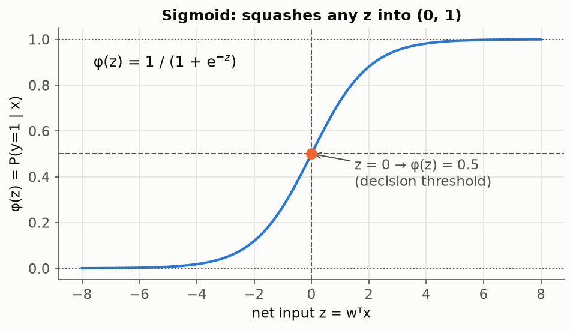

Sigmoid values to remember: φ(0)=0.5, φ(1)=0.73, φ(2)=0.88, φ(−1)=0.27.

**Relation to Adaline:** same neuron diagram. Adaline's activation = identity (z passes straight through); logistic's activation = sigmoid. Then a quantizer (threshold) gives the label.

**Output continuous or categorical? (2022 F)** → The sigmoid output is a **continuous probability** (0 to 1), and the **final prediction after the 0.5 threshold is categorical** (class label). So it's a *classifier*.

**Cost function (TT2 Q3), from maximum likelihood:**
- Likelihood L(w) = Π φ(z)^y (1−φ(z))^(1−y) (probability of seeing the labels we saw)
- Take log (product → sum: easier derivative, no underflow), flip sign to minimise:
- **J(w) = Σ [ −y log φ(z) − (1−y) log(1 − φ(z)) ]**
- Single instance: **if y=1: J = −log φ(z); if y=0: J = −log(1−φ(z))**

**The plot** (x-axis φ(z) from 0 to 1, y-axis J):

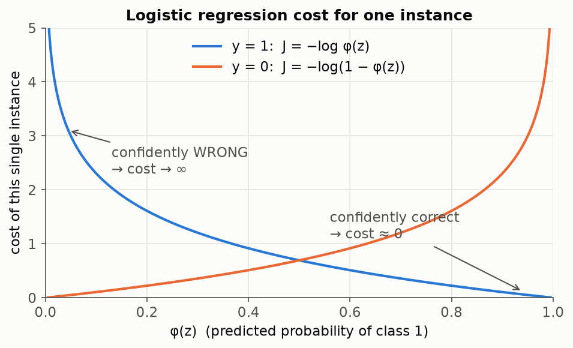

- y=1 curve: cost → 0 when φ(z) → 1 (right guess), → ∞ when φ(z) → 0 (confidently wrong).
- y=0 curve is the mirror image.
- Point to say: **wrong predictions with high confidence get huge penalties.**

**Update rule:** Δwⱼ = η Σ (y⁽ⁱ⁾ − φ(z⁽ⁱ⁾)) xⱼ⁽ⁱ⁾. It has the same form as Adaline's, with φ(z) as the output.

Mini numerical: w₀=−1, w=[0.5, 1], x=[2, 1] → z = −1+1+1 = 1 → φ = 0.731 → class 1. Cost if y=1: −ln 0.731 = 0.313; if y=0: −ln 0.269 = 1.313.

---

## 3. Overfitting, Underfitting, Regularization

**Picture.** Studying for an exam:
- **Underfit (high bias):** you learned one rule ("answer is always C"). Bad on practice AND exam.
- **Overfit (high variance):** you memorised the practice answers word by word. 100% on practice, fail the real exam.
- **Good fit:** you understood the pattern.

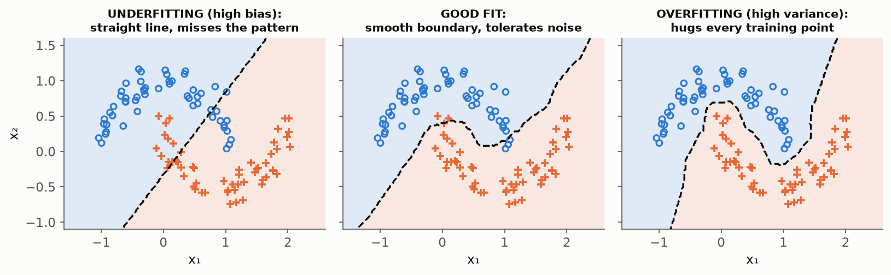

**2024 F 6b-ii figures (three boundary plots):**
- **Straight line** that misclassifies many points → **underfitting**
- **Smooth gentle curve** that separates most points (a few errors) → **good fit**
- **Wiggly curve snaking around every single point** → **overfitting**

**How to reduce overfitting:** (1) more training data, (2) **regularization (L2, smaller C)**, (3) simpler model / fewer features (feature selection, dimensionality reduction), (4) for trees: **pruning / limit max_depth**, use random forest, (5) cross-validation to tune hyperparameters.

**Regularization:** adding information (a penalty) to stop the model being too complex. It filters out noise.

**L2 (weight decay), 2020 5f:**
- J_new = J(w) + **(λ/2)‖w‖²** = J + (λ/2) Σ wⱼ²
- Big weights cost extra, so the optimiser keeps weights small, so the boundary is smoother and the model can't chase noise, so overfitting drops.
- Gradient of w² is 2w, so every update shrinks each weight in proportion to its size ("weight decay").
- λ bigger → stronger regularization.

**C = 1/λ** (sklearn & SVM):
- **Large C** → weak regularization → fits training hard → **overfit risk**
- **Small C** → strong regularization → **underfit risk**

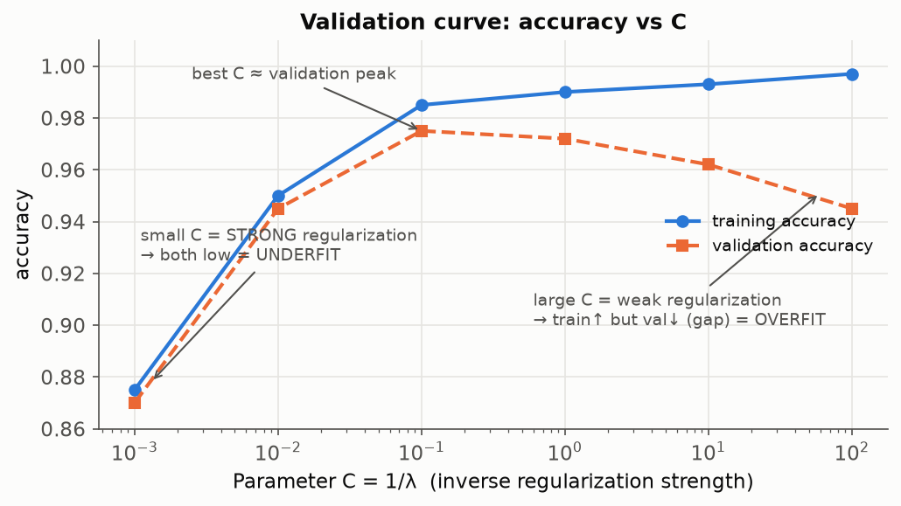

**TT2 Q4 plot (accuracy vs C, training solid, validation dashed):**
- Small C (10⁻³): both accuracies low (~0.89) → **underfitting** (too much regularization).
- C ≈ 0.1–1: both high and close (~0.98) → **sweet spot, best C ≈ 0.1 to 1**.
- Large C (10¹–10²): training keeps rising (~0.99) but validation **drops** (~0.955), and the gap widens → **overfitting** (too little regularization).

---

## 4. SVM

**Picture.** Two groups of kids on a playground. Draw the road between them that is **as wide as possible**. The kids standing right at the edge of the road are the **support vectors**. Only they decide where the road goes; everyone else could leave and nothing changes.

**Maximum-margin classifier (2020 5a, write this):**
1. Many lines can separate the classes; SVM picks the one with the **largest margin**.
2. Margin = distance between the decision boundary and the closest training points (**support vectors**).
3. Two parallel planes: w₀ + wᵀx_pos = **+1** and w₀ + wᵀx_neg = **−1**. Distance between them: **margin = 2/‖w‖**.
4. Maximise 2/‖w‖ ⟺ **minimise ½‖w‖²**, subject to **y⁽ⁱ⁾(w₀ + wᵀx⁽ⁱ⁾) ≥ 1** for every sample (each point on its correct side).
5. Solution: w = Σ αᵢ yᵢ xᵢ, where αᵢ = 0 for every non-support-vector, so only support vectors define the boundary.
6. Why wide? **Larger margin → lower generalization error**; a small margin tends to overfit.

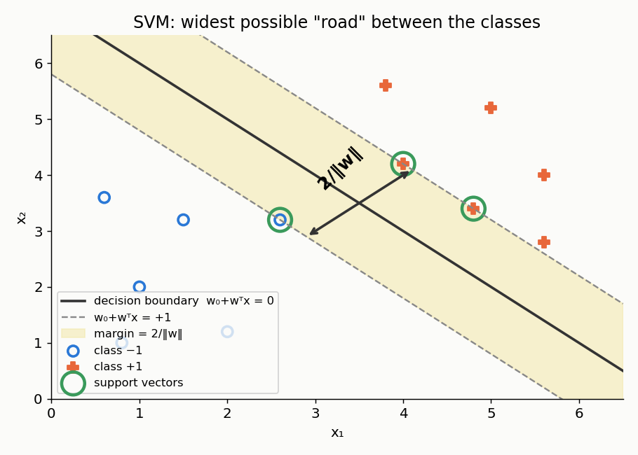

Mini numerical: w = [3, 4] → ‖w‖ = 5 → margin = 2/5 = **0.4**.

**Slack variables ξ (soft margin):** real data overlaps, so the hard rule "everyone on the right side" is impossible. Each sample gets ξᵢ ≥ 0 that lets it sit **inside the margin or even on the wrong side**, at a cost:
- minimise **½‖w‖² + C Σ ξᵢ**, constraint y(w₀+wᵀx) ≥ 1 − ξᵢ
- Lets the optimisation converge on non-separable data.

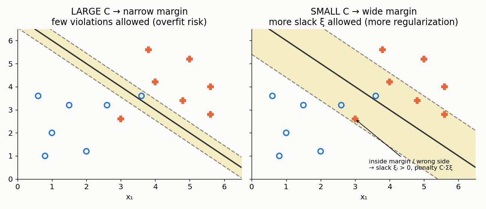

- **Large C** → violations expensive → **narrow margin**, close fit (overfit risk). **Small C** → **wide margin**, more tolerant (more regularization). Same role as C in logistic regression.

---

## 5. Kernel trick (asked in every final)

**Picture.** XOR: (0,0)→0, (1,1)→0, (0,1)→1, (1,0)→1. In 2D, no straight line separates them. Imagine the points are coins on a table: you can't separate them with a ruler. **Lift some coins into the air** (add a 3rd dimension, e.g. x₃ = x₁·x₂ or x₁²+x₂²) and now a flat sheet of paper slides between them. That's mapping to a higher dimension.

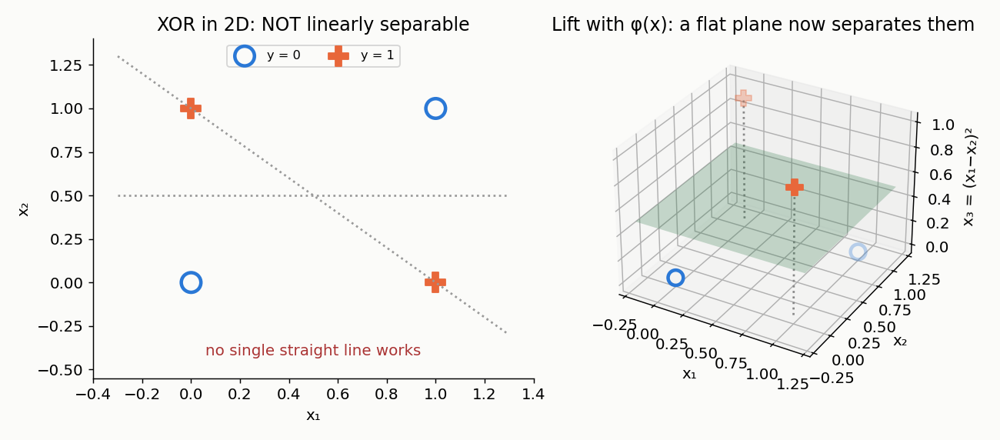

**Blueprint (4 steps):**
1. Map data to higher dimension with φ(x).
2. Train a linear SVM there (a flat hyperplane in the new space = a curved boundary back in 2D).
3. Map new data with the same φ.
4. Classify with that linear SVM.

**Problem:** computing φ for high dimensions is very expensive.

**The trick:** SVM only ever needs **dot products** φ(x)ᵀφ(z), never the coordinates themselves. So define a **kernel k(x, z) = φ(x)ᵀφ(z)** that computes that dot product **directly from the original x, z**, without ever building φ.

**Worked example (polynomial kernel, slide 30):** k(x,z) = (xᵀz)². For 2D: φ(x) = (x₁², √2 x₁x₂, x₂²).
x=(1,2), z=(3,4): xᵀz = 11 → k = **121**.
Explicit: φ(x)=(1, 2√2, 4), φ(z)=(9, 12√2, 16) → 9 + 48 + 64 = **121**. Same answer, but the kernel skipped building 3-D vectors.

**RBF (Gaussian) kernel, the most used:**
**k(x, z) = exp(−γ ‖x − z‖²)**, γ = 1/(2σ²)
- Reads as a **similarity**: identical points → 1, far apart → 0.
- γ is a hyperparameter: **large γ → tight, wiggly boundary (overfit)**; small γ → smooth boundary.

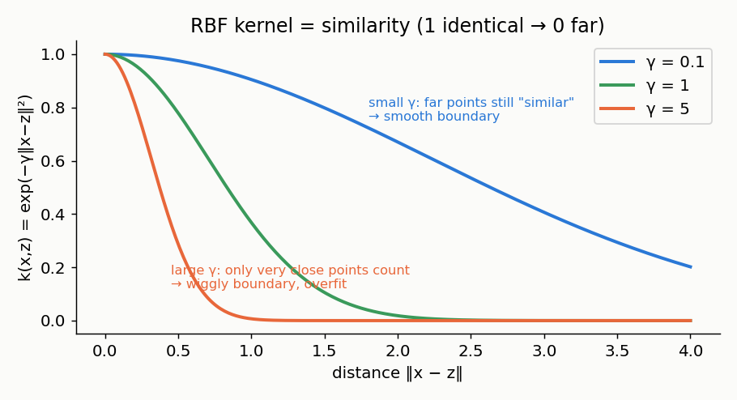

- e.g. x=(1,2), z=(2,4), γ=0.5: ‖x−z‖² = 1+4 = 5 → e^(−2.5) = **0.082** (not very similar).

**2-mark "Why kernel trick?":** to classify **non-linearly separable** data with a linear SVM by implicitly mapping to a higher-dimensional space where it becomes separable, **without the cost of computing the mapping explicitly**.

---

## 6. Decision Trees (the guaranteed numerical)

**Picture.** A game of 20 Questions. Each node asks a yes/no question about one feature ("Weather = Sunny?"). Follow the answers down to a **leaf** that says the class. Good questions split the pile into **unmixed** piles.

**Structure (2022 F 2f):** **Root node** (the whole dataset, first/best question) → **internal (decision) nodes** (a test on a feature, e.g. "petal width ≤ 0.75?") → **branches** (outcomes of the test) → **leaf nodes** (class label). Interpretable: you can read the rules.

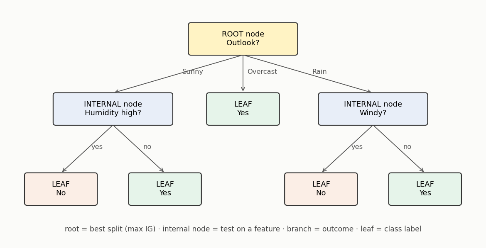

**Algorithm:** (1) start at the root with all data, (2) split on the feature with the **largest information gain**, (3) repeat on each child until leaves are pure, (4) **prune / limit max_depth** because deep pure trees overfit. sklearn builds **binary** trees.

**Formulas (memorise):**
- **IG = I(parent) − Σ (Nⱼ/Nₚ)·I(childⱼ)** (parent impurity minus weighted average of child impurities)
- **Gini = 1 − Σ pᵢ²** (0 pure, 0.5 for a 50/50 two-class mix)
- **Entropy = −Σ pᵢ log₂ pᵢ** (0 pure, 1 for 50/50)
- **Classification error = 1 − max pᵢ** (good for pruning, **bad for growing**: not sensitive enough)

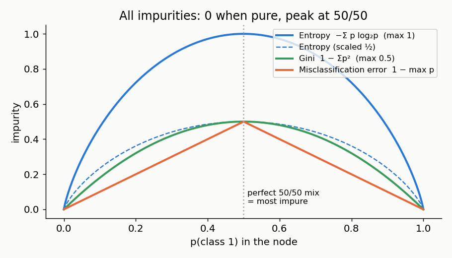

Most impure of (20,20), (40,0), (30,10)? → **(20,20)**: Gini 0.5, entropy 1. (30,10): Gini 0.375. (40,0): 0.

### Numerical 1: 2020 5b, split A vs B (also slide 41)

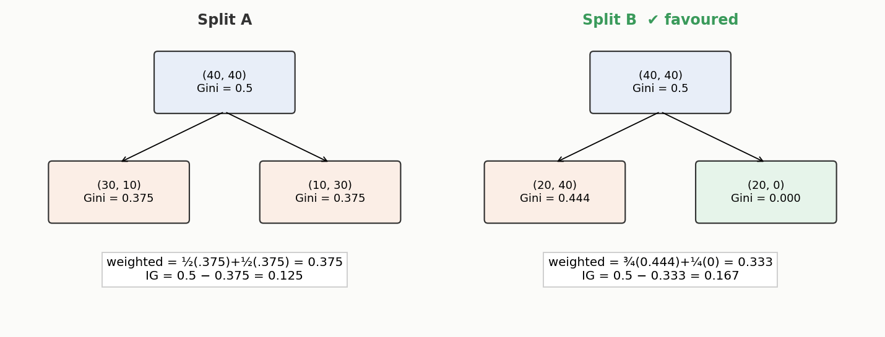

Parent (40,40): Gini = 1 − 0.5² − 0.5² = **0.5**

**A → (30,10) and (10,30):**
- each child: 1 − (3/4)² − (1/4)² = 1 − 0.5625 − 0.0625 = 0.375
- weighted: (40/80)(0.375) + (40/80)(0.375) = 0.375
- **IG_A = 0.5 − 0.375 = 0.125**

**B → (20,40) and (20,0):**
- left: 1 − (1/3)² − (2/3)² = 1 − 1/9 − 4/9 = **4/9 = 0.444**
- right: pure → 0
- weighted: (60/80)(4/9) + (20/80)(0) = 0.333
- **IG_B = 0.5 − 0.333 = 0.167**

**→ B is favoured** (0.167 > 0.125) because its right child is completely pure.
Bonus line for marks: classification error gives **both IG = 0.25** and can't tell them apart; entropy also picks B (0.31 vs 0.19).

### Numerical 2: 2024 F 3b-i, Weather vs Temperature
Rows: 1 Sunny Hot No · 2 Sunny Hot No · 3 Overcast Hot Yes · 4 Rain Mild Yes · 5 Rain Cool Yes · 6 Rain Cool No · 7 Overcast Cool Yes · 8 Sunny Mild No

Parent: 4 Yes, 4 No → **Gini 0.5**

**Weather:**
- Sunny {1,2,8} = No,No,No → 0
- Overcast {3,7} = Yes,Yes → 0
- Rain {4,5,6} = Y,Y,N → 1 − 4/9 − 1/9 = 4/9
- weighted = (3/8)(0) + (2/8)(0) + (3/8)(4/9) = **0.167** → **IG = 0.333**

**Temperature:**
- Hot {1,2,3} = N,N,Y → 4/9
- Mild {4,8} = Y,N → 0.5
- Cool {5,6,7} = Y,N,Y → 4/9
- weighted = (3/8)(4/9) + (2/8)(0.5) + (3/8)(4/9) = **0.458** → **IG = 0.042**

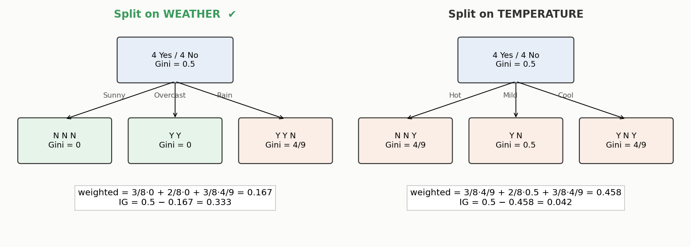

**→ First split on Weather.** Gut check: Weather already gives two pure piles.

**Recipe for ANY table:** count parent → Gini. For each feature: make piles, Gini per pile, weight by pile size/total, subtract from parent. Biggest IG wins.

---

## 7. Random Forest, Bootstrapping, Ensembles, Boosting

**Picture.** Ask one friend → they may be biased. Ask 100 friends who each saw slightly different info and take a **vote** → much more reliable. Each friend = one tree.

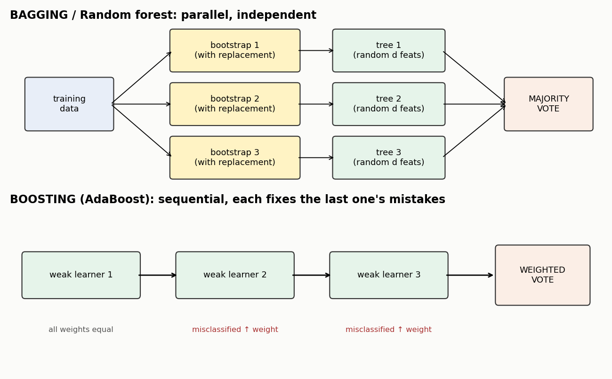

**Random forest (4 steps):**
1. **Bootstrap sample:** draw n samples from training data **with replacement**.
2. Grow a tree; at each node pick **d random features** (without replacement), split on the best of those (d ≈ √m).
3. Repeat k times (k trees).
4. **Majority vote.**
Hyperparameters: k (more trees = better but slower), n (bootstrap size, usually = training size), d.
Single trees overfit (high variance); averaging many cancels the noise. Forests rarely need pruning.

**Bootstrapping (2020 4g):** creating a new training set of the same size by **random sampling with replacement**. The same example can appear multiple times and some not at all (~37% left out). Each tree sees different data, so the trees are diverse.
- With replacement: put the ball back, probabilities stay the same, draws independent.
- Without replacement: ball stays out, the next draw depends on previous ones.

**Ensemble goal & limitation (2024 1g, 2020 6b-i):**
- Goal: combine many (weak) models into one stronger, more robust model with lower error/variance than any single one.
- **Limitation:** **higher computational cost** (train/store many models) and **loss of interpretability** (can't read 100 trees like one).

**Boosting / AdaBoost (2024 3b-ii, 2020 6b-ii):** tutors who learn from each other's mistakes.
1. Give all training samples **equal weights**.
2. Train a **weak learner** (e.g. a decision stump, one-level tree, slightly better than guessing).
3. **Increase the weights of misclassified samples**, decrease the correct ones.
4. Train the next weak learner on the re-weighted data; it focuses on the hard cases.
5. Repeat for several rounds.
6. Final = **weighted majority vote** (more accurate learners get bigger say).
- Example: spam filter. Stump 1 "contains 'free'?" misses some spam; those emails get heavier; stump 2 learns "many links?"; stump 3 learns "unknown sender?". Combined, they're strong.
- **Bagging vs boosting:** bagging (random forest) = **parallel, independent** bootstrap samples, reduces **variance**; boosting = **sequential**, each fixes the previous one's errors, reduces **bias**.

---

## 8. KNN

**Picture.** New kid at school. To guess which group they'll join, look at the **k kids standing closest** and go with the majority.

**Algorithm:** (1) choose **k** and a **distance metric**, (2) find the k nearest training points, (3) **majority vote**.
- "k" (2024 1b) = **the number of nearest neighbours consulted** for the vote. Small k → noisy/overfit; large k → too smooth/underfit; pick odd k for 2 classes.
- Distances: **Euclidean (p=2)** √Σ(xᵢ−yᵢ)², **Manhattan (p=1)** Σ|xᵢ−yᵢ| (Minkowski general). **Scale features first**.

**Lazy learner (2024 5e, 2020 5c):** it does **no training**. It just stores the whole training set and does all the work at prediction time (computing distances to every point). Other supervised algorithms (logistic, SVM) **learn parameters during training and then can throw away the data**; KNN is **non-parametric / instance-based** and keeps it all.
- **Advantage:** adapts instantly to new data, no retraining, simple.
- **Disadvantage:** slow prediction (cost grows linearly with data size), memory heavy, sensitive to scale, curse of dimensionality. KD-trees help.

**Tie in majority vote:** use odd k, or **weight votes by distance** (closer neighbour counts more), or fall back to the single nearest neighbour's class, or reduce k. (sklearn: picks the class whose neighbour comes first / is closer.)

**Curse of dimensionality (2024 1d, 2020 4a):** with a fixed number of training samples, **as the number of features (dimensions) grows, the feature space becomes very sparse**. Even the "nearest" neighbours are far away, so distance stops meaning similarity and KNN **overfits**. Fix: feature selection / dimensionality reduction (PCA).

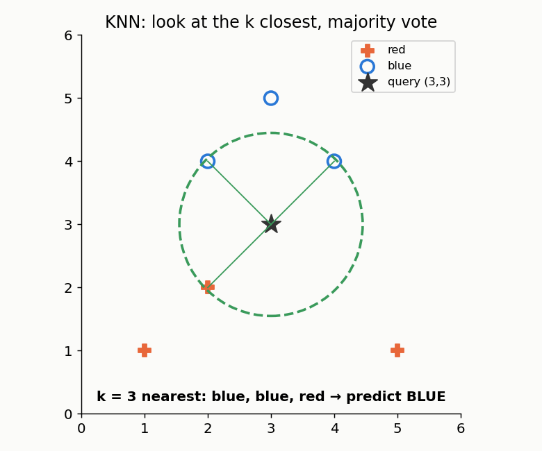

Mini numerical: query (3,3), k=3, Euclidean. Training: A(1,1) red 2.83, B(2,4) blue 1.41, C(4,4) blue 1.41, D(5,1) red 2.83, E(3,5) blue 2.0, F(2,2) red 1.41. Nearest 3 = B, C, F → blue, blue, red → **blue**.

---

## 9. Hyperparameter vs parameter (2-mark staple)
**Hyperparameter** = set by you **before** training, not learned: k in KNN, C and γ in SVM, λ, learning rate η, max_depth, number of trees k, epochs.
**Parameter** = learned from data: weights w, bias.

**Parametric vs non-parametric:** parametric = fixed number of parameters, data discarded after training (logistic regression, linear SVM, perceptron). Non-parametric = complexity grows with data (KNN, decision tree, random forest, kernel SVM).

## 10. Summary table (slide 35)
| Model | Good | Bad |
|---|---|---|
| Logistic regression | probabilities, fast, interpretable | assumes roughly linear boundary |
| Linear SVM | robust margin, good in high dims | not naturally probabilistic |
| Kernel (RBF) SVM | non-linear boundaries | slow on huge data, needs tuning (C, γ) |
| Decision tree | interpretable, no scaling needed | overfits unless pruned |
| Random forest | robust, rarely overfits | less interpretable, slower |
| KNN | simple, no training, adapts instantly | slow prediction, scale-sensitive, curse of dim |

---

## 🆘 15-minute doomsday box
1. **Gini = 1 − Σp²; IG = parent − Σ(Nⱼ/N)·child.** Biggest IG wins. (40,40) → A 0.125, **B 0.167 wins**. Weather/Temp → **Weather 0.333** vs 0.042.
2. **Sigmoid φ(z) = 1/(1+e⁻ᶻ)**; cost **−y log φ − (1−y) log(1−φ)**; plot = two crossing curves blowing up when confidently wrong. Output: probability continuous, label categorical.
3. **SVM:** maximise margin **2/‖w‖** ⟺ min ½‖w‖², s.t. y(w₀+wᵀx) ≥ 1; support vectors decide everything. Slack ξ allows violations; **large C = narrow margin/overfit, small C = wide/underfit**.
4. **Kernel trick:** map to higher dim where linearly separable (XOR); SVM only needs dot products, so k(x,z)=φ(x)ᵀφ(z) is computed directly. RBF = exp(−γ‖x−z‖²) = similarity.
5. **Overfit** = wiggly boundary, high variance; **underfit** = straight line, high bias. Fix overfit: more data, regularization (L2 / smaller C), simpler model, pruning, cross-validation.
6. **Random forest:** bootstrap (with replacement) → tree on random d features → repeat k → majority vote. **Boosting:** sequential, up-weight misclassified samples, weighted vote.
7. **KNN:** k = number of neighbours; lazy = no training, stores data; tie → odd k / distance weighting; curse of dim = sparse space, neighbours far.
