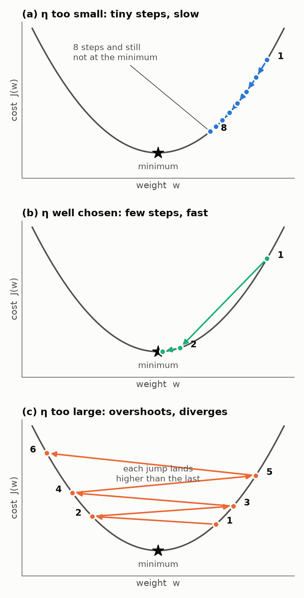
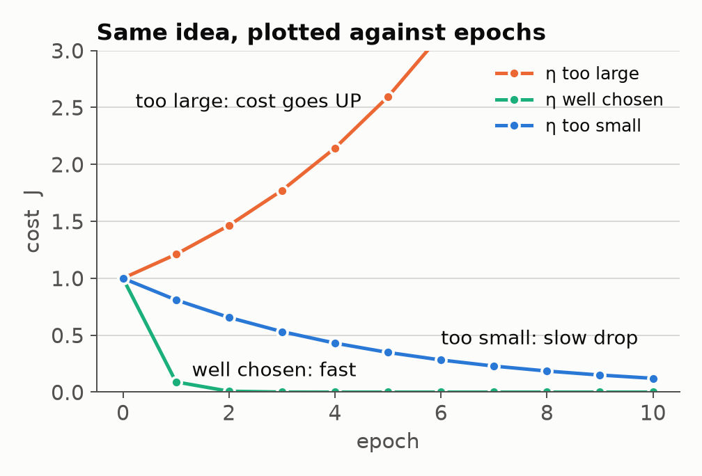

# Role of the learning rate in gradient descent

> **Asked:** TT1 2019, TT1 2020
> "What is the role of learning rate when minimizing cost function with gradient descent? Show with a figure."

## Answer to write

Gradient descent updates every weight by taking a step **against the gradient** of the cost J(w):

  w := w + Δw,  Δw = −η ∇J(w)  (per weight: Δwⱼ = −η ∂J/∂wⱼ)

- The **gradient** gives the **direction** (downhill).
- The **learning rate η** (a small positive number, e.g. 0.01) gives the **size of the step**.

So η controls how fast and whether the cost reaches its minimum w*:

| η | What happens |
|---|---|
| Too small | Tiny steps. Converges, but needs very many epochs (slow). |
| Too large | Overshoots w*, jumps to the other side and lands higher. Cost grows each epoch. **Diverges.** |
| Well chosen | Reaches the minimum in a reasonable number of steps. |

## Figure

**How to draw it in the exam** (2 bowls is enough, 3 is better):

- Draw a U-shaped curve. Label the x-axis **weight w** and the y-axis **cost J(w)**. Put a star at the bottom and label it **global minimum**.
- **(a) Too small:** many dots close together on one side, creeping down. Write "slow".
- **(b) Good:** 2 or 3 big arrows straight down to the star.
- **(c) Too large:** a zig-zag that crosses the bowl and climbs higher each jump. Write "diverges".
- Label point 1 as **initial weight**.

## Extra marks

- **Second way to show it:** plot J against epochs. Small η gives a slowly falling curve. Large η gives a curve that goes **up**.

  

- **Raschka's Adaline example:** η = 0.01 made the error blow up, and η = 0.0001 converged but very slowly. After **standardizing the features**, η = 0.01 converged quickly.
- **Choosing η:** try 0.1, 0.01, 0.001 and pick the one whose cost drops fastest without bouncing.

## Doomsday (1 minute)

> The learning rate η sets the step size in Δw = −η∇J(w). If it's too small, convergence is slow. If it's too large, the steps overshoot the minimum and the cost diverges.

Draw two bowls: (a) tiny steps on one side, (c) a zig-zag climbing out.
