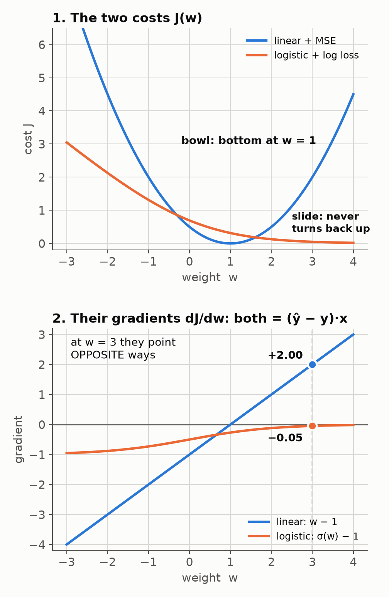

# Same gradient formula, different functions

Linear regression (MSE) and logistic regression (log loss) both end up with

  ∇J = (1/n) Σ (ŷᵢ − yᵢ) xᵢ

Your thought was: "same gradient, so the two costs must differ by a constant." **That rule is correct.** If ∇f = ∇g at every point, then f = g + C. It just doesn't apply here, and the reason is one small thing.

## The catch: ŷ is a disguise

The formula is the same in terms of **ŷ**, but gradient descent differentiates with respect to **w**, and ŷ depends on w differently in each model:

| | ŷ is | Gradient written in w |
|---|---|---|
| Linear | wᵀx | (wᵀx − y) x |
| Logistic | σ(wᵀx) | (σ(wᵀx) − y) x |

Once ŷ is written out, the two gradients are different functions of w. They aren't equal at every w, so the "constant apart" rule never kicks in.

**Same trick in plain calculus:** the derivative of ½u² is u·u′.
- If u = w, that gives w.
- If u = sin w, that gives sin w · cos w.

"u·u′" is the same formula both times, but the functions are completely different. ŷ plays the role of u here.

## See it with numbers

Take one example: x = 1, y = 1, no bias.
- Linear: J = ½(w − 1)²
- Logistic: J = −ln σ(w)

| w | J linear | J logistic | difference | gradient linear | gradient logistic |
|---|---|---|---|---|---|
| −2 | 4.50 | 2.13 | −2.37 | −3.00 | −0.88 |
| 0 | 0.50 | 0.69 | +0.19 | −1.00 | −0.50 |
| 1 | 0.00 | 0.31 | +0.31 | 0.00 | −0.27 |
| 3 | 2.00 | 0.05 | −1.95 | **+2.00** | **−0.05** |

- The difference column changes from row to row, so there's no constant.
- At w = 3 the gradients have **opposite signs**. Linear says "decrease w"; logistic says "increase w".

## "So do I just remap w?"

No. Remapping w (substituting w = g(u)) changes the gradient as well, because the chain rule multiplies it by g′(u). The formulas would stop matching. Nothing needs fixing anyway: these are two different costs that happen to produce the same-looking update.

## Then why do they look the same? Not a coincidence

Each loss is **chosen to match its output function**, so the derivative with respect to the net input z comes out as exactly ŷ − y.

**Logistic, step by step** (one example, ŷ = σ(z)):

 J = −[ y ln ŷ + (1 − y) ln(1 − ŷ) ]
 dJ/dŷ = (ŷ − y) / (ŷ(1 − ŷ))
 dŷ/dz = σ′(z) = ŷ(1 − ŷ)
 dJ/dz = dJ/dŷ · dŷ/dz = **ŷ − y**  (the ŷ(1 − ŷ) cancels)

**Linear:** J = ½(z − y)², so dJ/dz = z − y = **ŷ − y** directly.

**Softmax + cross-entropy:** dJ/dzₖ = **ŷₖ − yₖ**. It's the same pattern again.

Finally, z = wᵀx, so dz/dw = x. That's where the (ŷ − y)·x comes from.

**Why it's useful:** the update code is identical. You write Δw = η Σ(y − ŷ)x once and change only the line that computes ŷ. This is why Raschka builds logistic regression by copying Adaline and swapping the activation.

## What if you mix the pair? (sigmoid + MSE)

 J = ½(σ(z) − y)²  gives  dJ/dz = (ŷ − y) · σ′(z)

The extra σ′(z) is never more than 0.25, and it's close to 0 when the sigmoid is saturated (squashed flat near 0 or 1).

Example: the model is confidently wrong, with ŷ = 0.01 and y = 1.
- Sigmoid + MSE gradient ≈ **−0.0098**, so it barely learns.
- Sigmoid + log loss gradient ≈ **−0.99**, which is 100× bigger and fixes the mistake fast.

That's the real reason sigmoid is paired with log loss.

## One correction to DeepSeek's text

It called the log loss surface "sigmoid-shaped". It isn't. For one example it's ln(1 + e⁻ʷ), the orange curve in panel 1: a convex slide. Like the MSE bowl it's convex, so gradient descent can't get stuck in a bad local minimum.

## One line to keep

> The gradients look the same because each loss is matched to its output function (dJ/dz = ŷ − y). They're different because ŷ depends on w differently. "Equal gradients ⇒ constant apart" needs the gradients to be equal at every w, and here they aren't.
